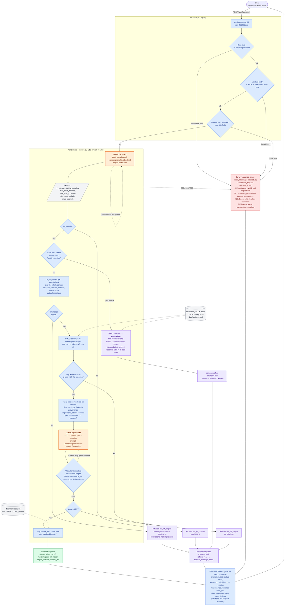
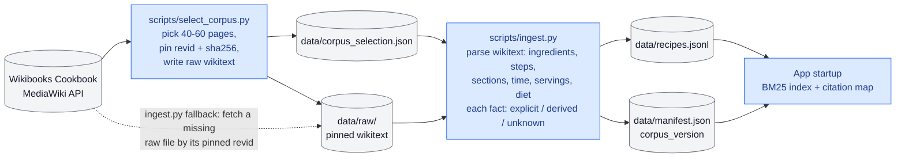

# Request pipeline: from question to answer

How a question travels through the service, which steps are deterministic
code and where the LLM is involved. The contract is SPEC.md §3; this page
is a picture of it and of the code in `recipe_qa/api.py` and
`recipe_qa/service.py`.

Legend: blue = deterministic code, orange = LLM call (Claude, structured
output), grey = committed data, red = HTTP error, purple = refusal
(HTTP 200, `refused: true`), green = answer.

## 1. Online: `POST /ask`

### Who decides what

| Step | Done by | What it decides |
|---|---|---|
| Rate limit, validation, concurrency | code | whether the request is served at all |
| Extract | LLM #1 | reads the question: is it about cooking, is it a safety question, which constraints it states. It never answers. |
| Domain and safety gates | code | `out_of_domain` and `safety` refusals, from the extracted flags |
| Eligibility | code | which recipes satisfy time, diet and ingredient constraints, over the whole corpus before ranking; none → `out_of_corpus` naming the constraints |
| Retrieval | code | which 3 recipes the model may see (BM25 over whole recipes, ADR 001) |
| Generate | LLM #2 | phrases an answer from those 3 recipes and names its sources, or says they cannot answer |
| Citation check | code | rejects any source ID outside the given 3; retries once, then 502 |
| Citations | code | titles and URLs come from the manifest, never from the model (I3) |

The model sees only the question (call 1) and three rendered recipes plus
the question (call 2). User text and recipe text are wrapped in tags with
angle brackets escaped, so neither can open or close a prompt tag.

## 2. Offline: building the corpus

Runs before deployment, never on a request. Its output is committed and
loaded into memory at startup.

No LLM is involved in ingestion: every metadata value is either stated on
the page or derived by a documented rule, with the evidence kept.
